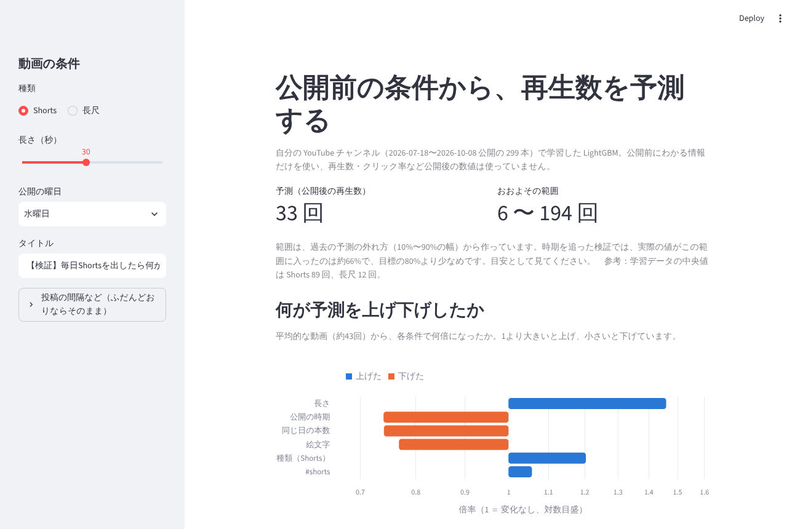

# youtube-views-predictor：公開前の条件から再生数を予測するアプリ

自分の YouTube チャンネル（2026年7〜10月に公開した299本）で学習した LightGBM を、Streamlit の画面にしました。動画の種類・長さ・曜日・タイトルなど**公開前にわかる情報**を入れると、公開後の再生数の予測と、その予測を「何が上げ下げしたか」（寄与の分解）が表示されます。



## できること
- 予測（公開後の再生数）と、おおよその範囲（過去の予測の外れ方の10%〜90%）
- 何が予測を上げ下げしたか：LightGBM の `pred_contrib`（TreeSHAP と同じ値）を倍率で表示
- 精度と限界の説明（画面の「このモデルについて」）

## モデルの精度（公開日順の時系列 CV・5分割）
| モデル | RMSE（log(1＋再生数)） |
|---|---|
| 中央値で当てる | 1.465 |
| 重回帰 | 1.271 |
| **LightGBM（このアプリ）** | **1.283** |

- 中央値より約12%小さいが、重回帰とほぼ同じ。効いているのは**種類と長さと公開の時期**
- 予測の範囲（10%〜90%）に実際の値が入ったのは、過去の fold の外れ方で作った場合に**約66%**（目標80%より少ない）。期間が進むと外れ方が変わるため。画面にもそのまま書いている

## 限界
- **予測であって因果ではない**。「曜日を変えれば再生数が上がる」とは言えない。打ち手の効果は、別に実験（実験1：前後比較、実験2：くじで分ける A/B）で確かめている
- Shorts 同士の差は、公開前の情報ではほとんど説明できない（Shorts だけで比べると中央値に勝てない）
- 1つのチャンネル・約3か月のデータ。学習範囲より先の時期は、最後の日として扱う

## 動かし方
```bash
pip install -r requirements.txt
streamlit run app.py
```
- `model/point.txt`（学習済みモデル）と `model/meta.json`（精度・範囲など）を読むだけなので、元のデータがなくても動きます
- 学習し直すとき：`python src/train.py <YouTube Studio の動画一覧 CSV>`。元の CSV は自分のチャンネルのデータなので、リポジトリには入れていません

## ファイル
| ファイル | 中身 |
|---|---|
| app.py | Streamlit の画面 |
| src/features.py | 公開時点の特徴量（youtube-data-mart の e_06 と同じ定義） |
| src/train.py | 時系列 CV・範囲の当たり方の確認・モデルの保存 |
| model/ | 学習済みモデルと meta.json |
| packages.txt | Streamlit Community Cloud 用（LightGBM が使う libgomp1） |

## 関連
- 分析の全体（データマート・重回帰・SHAP）：https://github.com/takayuki-0127/youtube-data-mart
- 予測の元になったノートブック：youtube-data-mart の `notebooks/e_06_predict_views.ipynb`

コード：MIT License
